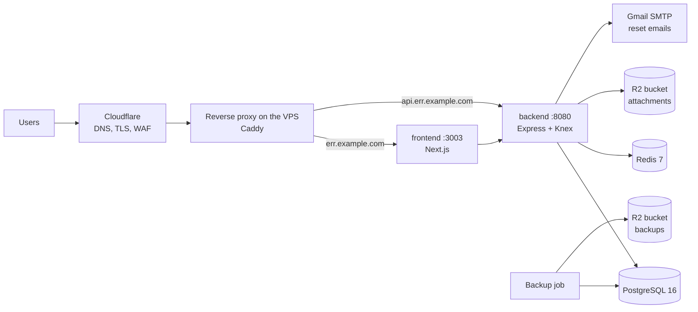

This section is for whoever runs the system. The user guides cover using the app; these pages cover keeping it up.

| Page | Read it when you need to |
|---|---|
| [Deployment](/operations/deployment) | set up the VPS, release a version, or roll one back |
| [Storage and backups](/operations/storage-and-backups) | configure Cloudflare R2 for attachments and database backups, or restore data |
| [Monitoring](/operations/monitoring) | see what is watched, who gets alerted, and what the thresholds are |
| [Runbook](/operations/runbook) | respond to an outage, a bad release or a lost server |

## Topology

Everything inside the VPS runs from `docker-compose.yml`: `db`, `redis`, `backend` and `frontend` on a private Docker network. `backend` and `frontend` also join the `caddy` network so Caddy can reach them by name. The app publishes no ports on the host; only Caddy is reachable from outside.

## Environments

| | Development | Staging | Production |
|---|---|---|---|
| `NODE_ENV` | `development` | `staging` | `production` |
| Database settings read from | `DB_*` | `STAGING_DB_*` | `PROD_DB_*` |
| Cache | Upstash Redis | Upstash Redis | Local Redis container |
| File storage | Cloudinary | Cloudinary | **Cloudflare R2** |
| Deploys from | your machine | branch `staging` | branch `main` |

The backend picks its database, cache and storage from `NODE_ENV`. Setting `NODE_ENV=production` is therefore what switches uploads to R2 and the cache to the local Redis. `docker-compose.yml` passes both the plain `DB_*` and the `PROD_DB_*` / `STAGING_DB_*` names so the container reaches the Compose database in any environment.

## Ownership and contacts

Fill these in once and keep them current. An alert nobody owns is the same as no alert.

| Role | Person | How to reach |
|---|---|---|
| Primary on-call | | |
| Backup on-call | | |
| Cloudflare account owner | | |
| VPS provider contact | | |
| Business owner (decides on data loss and downtime) | | |

## Targets

These are the targets the other pages are designed to meet. Revisit them with the business owner before go-live.

| Measure | Target | How it is met |
|---|---|---|
| Availability | 99.5% a month (about 3.6 hours down) | single VPS, fast restart, uptime alerts |
| Recovery time (RTO) | 4 hours | scripted rebuild from images and the latest backup |
| Data loss (RPO) | 24 hours | nightly database backup to R2 |
| Backup restore tested | monthly | restore drill in the [runbook](/operations/runbook) |

<Note>One VPS is a single point of failure. The targets above assume an outage is acceptable while the server is rebuilt. If the business needs better, the next step is a second VPS and a managed database, not more tooling on this one.</Note>
