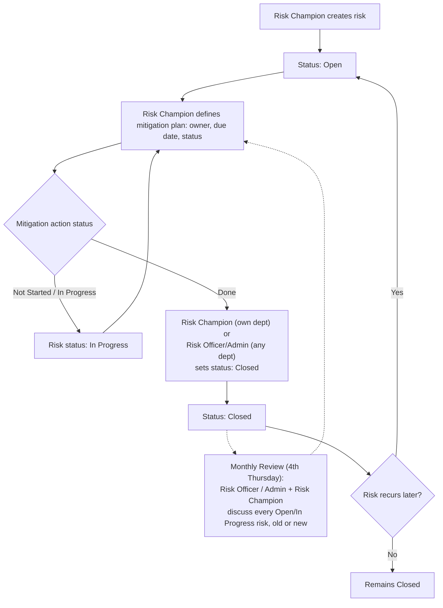
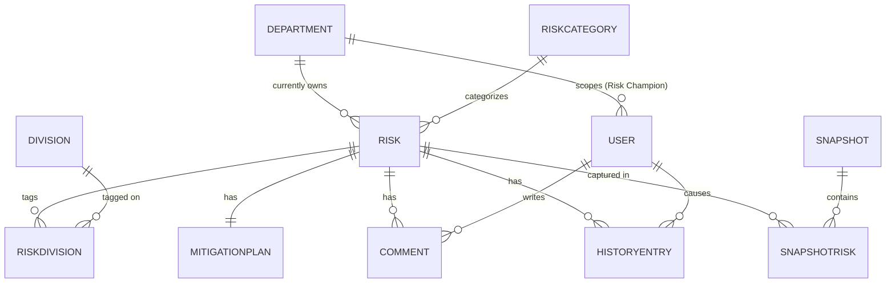

# Enterprise Risk Register (ERR) Portal — Software Requirements Specification

## 1. Document Control

| Field | Value |
|---|---|
| Title | Enterprise Risk Register (ERR) Portal — SRS |
| Version | 0.8 (Draft for stakeholder review) |
| Date | 2026-11-03 |
| Status | Draft — not yet approved |
| Document owner | Victor Wanyungu (IT) |
| Business approver | Fidelis Wanalwenge, Strategic Finance Unit (confirmed sole business sign-off authority — chat decision, 2026-11-03) |

### Change log

| Version | Date | Change |
|---|---|---|
| 0.1 | 2026-11-03 | Initial draft, built from source materials (current spreadsheet, amendments memo) and stakeholder Q&A. |
| 0.2 | 2026-11-03 | Incorporated stakeholder revisions: dual risk identifiers (system UUID + org-facing ID); full field-level audit scope clarified to explicitly include comments, status, risk response and category; read-time mapping of department categories to ExCo categories; cross-department risk transfer with retained history access; Risk-Champion-initiated archiving with Risk-Officer oversight; confirmed monthly review cadence (4th Thursday); bar-chart visualizations in place of colour-grid heat maps; explicit Admin ability to edit a risk's division tags; added current-state detail on cell-overwrite updates. |
| 0.3 | 2026-11-03 | Risk Champions may now also initiate a transfer of their own department's risks (previously Admin/Risk Officer only); added Part 2 (sections 9–17). |
| 0.4 | 2026-11-03 | Resolved OQ-17: the business/IT team will manually seed the database with current spreadsheet data before changeover; no in-app migration tool is required. |
| 0.5 | 2026-11-03 | Resolved all remaining open questions: no 4th read-only role; removed the two-step mitigation-closure rule (any permitted editor can close a risk directly); trend charts derive from continuously-tracked risk state, not snapshots; overdue-review threshold confirmed at 30 days; password complexity/length policy remains explicitly deferred, refresh tokens confirmed at a 1-day lifetime; ExCo↔department category mapping confirmed many-to-many; all remaining NFR/data-retention/UX open questions resolved to their proposed defaults. |
| 0.6 | 2026-11-03 | Corrected the category model: there is no department-owned vs. ExCo-owned category split and no mapping between them — just one single, shared, organisation-wide Risk Category list that every department uses and that the Enterprise View rollup groups by directly. Supersedes D-07 (partially), D-12, and D-25. FR-ADMIN-003 and FR-ADMIN-005 are Withdrawn; BR-11 is Withdrawn; FR-ENT-003 and BR-09 rewritten. |
| 0.7 | 2026-11-03 | Closed the amendments-memo gap on "department buttons" (added FR-DEPT-004): the Departmental View is now explicitly framed as each department's own dashboard, with a direct link to it from both the Dashboard and the Risk Register, not only via the Enterprise View. |
| 0.8 | 2026-11-09 | Added BR-12 (a review = a comment added that month; "last reviewed" is derived from the most recent comment) and BR-13 (Active/Inactive status, derived from risk status). Reworked FR-DASH-004 into a snapshot-based monthly rating trend, selectable by organisation/category/individual risk (supersedes D-22 for the monthly case only); added average-rating-by-category to the merged analytics (FR-DASH-003); updated FR-DASH-008's overdue logic and FR-REG-005's filtering to match. Raised OQ-18 (should snapshotting become automatic, now that analytics depend on it). |

### Status-tag legend

| Tag | Meaning |
|---|---|
| **[C]** | Confirmed in the sources — source is named |
| **[P]** | Proposed by the analyst — needs stakeholder approval |
| **[TBD]** | Not enough information — linked to an open question (section 15) |
| **[D]** | Confirmed, deferred to a named later release |
| **[OUT]** | Explicitly out of scope |

---

## 2. Purpose, Audience and Scope

### Purpose

This SRS specifies the requirements for a new **Enterprise Risk Register (ERR) Portal**, to be built from scratch, that replaces the organisation's current manual Excel-based risk tracking process. It is the contract between the business (represented by the named business approver) and the build team.

### Audience

IT development team (build), department Risk Champions and the Risk Officer (daily users), the business approver (sign-off), and management/ExCo (consumers of the Enterprise View).

### In scope

- Department-scoped risk register (create/edit/view risks) with a dual identifier per risk: an internal system UUID and a stable, human-facing department-prefixed org ID — **[C]** xlsx (org ID convention), chat decision (dual-ID scheme).
- Risk scoring and a risk-distribution view using the corrected Likelihood × Impact bands, rendered as bar charts rather than colour-grid heat maps — **[C]** PDF memo, chat decision.
- Structured mitigation-plan tracking (owner, due date, status) and a monthly review/confirm-closed workflow — **[C]** PDF memo, chat decision.
- An append-only comments thread per risk — **[C]** chat decision.
- A full field-level audit history per risk, explicitly covering (at minimum) title, description, comments, status, risk response, category, mitigation plan, division tags and owning department — **[C]** chat decision.
- The ability to transfer a risk to another department while preserving its identifier and full history, with read-only access retained by the originating department — **[C]** chat decision.
- Point-in-time register snapshots and period-over-period comparison, replacing manual monthly tab-copying — **[C]** PDF memo ("master register... per month"), chat decision.
- Role-based access for three roles: Admin, Risk Officer, Risk Champion — **[C]** chat decision.
- A combined Dashboard (period filter, a monthly review panel covering every Open/In Progress risk regardless of when it was raised, former Analytics content, monthly **and** weekly trend views) — **[C]** PDF memo, chat decision.
- A Departmental View (risk distribution chart, highest-rated risks with mitigation plans, ratings trend) — **[C]** PDF memo.
- A single, combined Enterprise View (department summary + a rollup by risk category, both drawn from one shared, organisation-wide category list) for Admin/Risk Officer — **[C]** PDF memo, chat decision.
- CSV/data export, scoped to the exporting user's visible data — **[P]** standard reporting capability.
- Division-impact tagging against the organisation's 6 fixed divisions, editable by Admin regardless of department — **[C]** xlsx, chat decision.

### Deferred

None confirmed by the business at this time. Candidate later-release items are recorded as open questions in section 15 rather than assumed deferred.

### Out of scope

- Any integration with finance, HR/payroll, or other enterprise systems — **[OUT]**: no source mentions any integration; none is assumed.
- Automated email/push notifications — **[D]**, chat decision 2026-11-03: deferred past v1; an in-app, 30-day overdue indicator (FR-DASH-008) is in scope, but outbound reminders are not. Revisit after v1 usage.
- Multi-company / multi-tenant support — **[OUT]**: all sources describe a single organisation.
- An in-app bulk-import/migration tool from `SDG_Risk_Register_2026.xlsx` — **[OUT]**, chat decision 2026-11-03: the business/IT team will manually seed the database with the spreadsheet's current data directly, before changeover.

---

## 3. Business Context

### Current-state process

**[C, xlsx analysis]** The organisation currently tracks risk in a shared workbook, `SDG_Risk_Register_2026.xlsx`. Eight departments (People, Finance, Legal, IT, Projects, HSSE, Commercial, Supply Chain) each maintain their own tab, logging risks under a department-prefixed, manually-assigned ID (e.g. `IT-01`), scoring each on Impact × Likelihood (1–5 each), and flagging which of 6 fixed organisational divisions (Development Management, Mechanical, Civil, Electrical, TLM, Corporate Services) each risk affects. A risk is updated today by directly overwriting the cells in its row; removing a risk means deleting its row; adding one means inserting a new row — none of these actions leaves any record of the prior value. Two separate sheets attempt an enterprise-level view: a `Summary` sheet counts risks per department, and a separate `Enterprise Risk Register` sheet independently re-averages risk scores into 11 ExCo-owned strategic categories (Strategic, Financial, Operational, Compliance & Legal, Reputational, Tech & Cyber, People & HC, Supply Chain & Procurement, HSSE, External, ESG) by string-matching the free-text category label typed on each department sheet, via long hardcoded-cell-range formulas. Monthly history is kept by manually copying an entire department's tab into a new dated tab (e.g. `Finance_June`, `Finance_July`, `Finance_Aug`); risks are frequently re-sorted and IDs renumbered by hand in the process, so there is no stable key to tell what actually changed between two months.

On 2 November 2026 the systems owner (Fidelis Wanalwenge, Strategic Finance Unit) issued a memo setting out 10 requirements for a new Enterprise Risk Register tool, covering a Dashboard, Risk Registers, Risk Heat Map scoring, an Enterprise View, and a Departmental View. The decision taken for this SRS (chat, 2026-11-03) is to build this tool **from scratch**, on the organisation's approved engineering stack — **[C]** `code/` repo's `synergetic-standards` skill (TypeScript, React, PostgreSQL + Knex, Better Auth).

### Pain points

| # | Pain point | Source |
|---|---|---|
| 1 | No reliable way to see what changed between two points in time: ordinary edits overwrite cells with no record of the previous value, and monthly "snapshots" are full manual copy-paste duplicates, re-sorted differently each time, with no stable diff key. | **[C]** xlsx analysis |
| 2 | Enterprise-level rollups are computed via fragile, hardcoded cell-range spreadsheet formulas that silently break or under-count when a department inserts or deletes a row. | **[C]** xlsx analysis |
| 3 | Two disconnected enterprise-level views exist (a per-department count sheet and a separately-computed per-category average-score sheet), with no single tool bringing them together. | **[C]** xlsx analysis |
| 4 | Risk IDs are not stable: they are manually renumbered by hand after merges, deletions, or re-sorts. | **[C]** xlsx analysis |
| 5 | Mitigation actions have no owner, due date, or status tracking today — only a free-text note — so there is no way to confirm month-to-month whether a mitigation was actually completed. | **[C]** PDF memo, xlsx analysis |
| 6 | Risk scoring bands stated in the amendments memo differ from those computed by the spreadsheet's formulas. | **[C]** PDF memo vs. xlsx; resolved by BR-01 |
| 7 | Risk categories are free text per department and rely on exact string matching for enterprise rollups; a typo or trailing space silently breaks the aggregation. | **[C]** xlsx analysis |

### Problem statement

- **Situation [C]:** Risk is tracked manually in a shared Excel workbook maintained independently by each department, with no dedicated software tool.
- **Core problem [P, synthesis]:** The process depends on manual discipline — formula upkeep, hand renumbering, free-text notes, direct cell overwrites — that has already visibly broken down, leaving no reliable way to track how risk changes over time or to trust any single enterprise-wide view.
- **Consequence [P]:** The Risk Officer and management cannot confidently answer "what changed since last month" or "what is our current enterprise risk exposure" without manual reconciliation, and mitigation follow-through cannot be verified.
- **Desired outcome [C, synthesis of PDF + chat]:** A single, purpose-built ERR portal that lets each department log and score risks reliably, gives the Risk Officer and Admin a trustworthy, always-reachable enterprise and departmental view with period-over-period comparison, and makes mitigation tracking and monthly review auditable.

### Business objectives

| ID | Objective | Success measure | Tag |
|---|---|---|---|
| BO-01 | Replace fragile, manually-maintained spreadsheet formulas with a single reliable source of truth for enterprise risk data. | Zero manually-maintained cross-sheet aggregation formulas in production; all rollups computed by application logic. | **[P]** |
| BO-02 | Make risk changes traceable over time, at both the individual-risk level and the organisation-wide level. | 100% of risk field edits (and comment additions) captured in an auditable history; a snapshot is retrievable for any closed review period without manual copying. | **[P]** |
| BO-03 | Provide a single, working, role-appropriate organisation-wide view, consolidating the two disconnected spreadsheet rollups (department counts and category averages) into one Enterprise View. | Admin and Risk Officer can reach the full Enterprise View (both components) on one screen, with no manual reconciliation across separate sheets required. | **[P]** |
| BO-04 | Standardise risk scoring so ratings are computed identically everywhere in the system. | Zero discrepancy between Dashboard, risk distribution chart, Departmental View, and Enterprise View for the same risk's rating. | **[P]** |
| BO-05 | Make mitigation-action follow-through verifiable on a monthly cadence. | At least 90% of mitigation actions have an assigned owner, due date and status, within 2 review cycles of go-live. | **[C]**, chat decision 2026-11-03 |

---

## 4. Roles and Permissions

### Roles

**[C]** chat decision, 2026-11-03 — three roles:

| Role | Description |
|---|---|
| **Admin** | Full system control: user accounts, departments, the shared risk category list, scoring configuration, and all data. |
| **Risk Officer** | Organisation-wide oversight: can view and manage risks across every department, owns the Enterprise View, triggers snapshots. |
| **Risk Champion** | Linked to one department; creates and maintains that department's risks and mitigation plans. |

**[C]** chat decision, 2026-11-03: no fourth, read-only ExCo/management role is added. ExCo/management view data through a Risk Officer/Admin login or an exported report (FR-RPT-001/002).

### Permission matrix

Scope qualifiers: "own dept" = limited to the Risk Champion's assigned department; "org-wide" = all departments.

| Capability | Admin | Risk Officer | Risk Champion | Tag |
|---|:---:|:---:|:---:|---|
| View risks (own dept) | ✓ | ✓ (all depts) | ✓ (own dept only) | **[C]** |
| View risks transferred out of own department (read-only) | — | — | ✓ (historical only) | **[C]** |
| View Enterprise View (combined dept summary + category rollup) | ✓ | ✓ | ✗ | **[C]** |
| View Departmental View (any dept) | ✓ | ✓ | ✓ (own dept only) | **[C]** |
| Create risk | ✓ | ✓ | ✓ (own dept only) | **[C]** |
| Edit risk, including its division tags | ✓ (any dept) | ✓ (any dept) | ✓ (own dept only) | **[C]** |
| Add a comment to a risk | ✓ | ✓ | ✓ (any risk they can view) | **[C]** |
| Mark a mitigation action's status | ✓ | ✓ | ✓ (own dept only) | **[P]** |
| Close a risk | ✓ (any dept) | ✓ (any dept) | ✓ (own dept only) | **[C]** |
| Archive a risk | ✓ (any dept) | ✓ (any dept) | ✓ (own dept only) | **[C]** |
| View archived risks | ✓ | ✓ | ✗ | **[C]** |
| Transfer a risk to another department | ✓ (any dept) | ✓ (any dept) | ✓ (own dept risks only) | **[C]** |
| View field-level audit history | ✓ | ✓ (any dept) | ✓ (own dept + read-only on transferred-out risks) | **[C]** |
| Trigger a register snapshot | ✓ | ✓ | ✗ | **[P]** |
| Compare two snapshots | ✓ | ✓ | ✓ (own dept only) | **[P]** |
| Manage departments & categories | ✓ | ✗ | ✗ | **[P]** |
| Manage the shared risk category list | ✓ | ✗ | ✗ | **[C]** |
| Manage user accounts & roles | ✓ | ✗ | ✗ | **[P]** |
| Export data | ✓ (org-wide) | ✓ (org-wide) | ✓ (own dept only) | **[P]** |

### Least privilege & separation of duties notes

- **[C]** chat decision, 2026-11-03: closing a risk is a normal edit action, not a separate confirmation step — the owning department's Risk Champion may close their own department's risk directly (typically once its mitigation action is marked Done), and Risk Officer/Admin may close any risk. This supersedes the two-step "mark Done, then confirm" rule proposed in revision 0.1/0.2.
- **[C]** Risk Champions may archive (soft-delete) their own department's risks; Admin and Risk Officer may archive any risk and always retain visibility into archived risks — including their full history — regardless of department. This gives departments control over their own register while preserving organisation-wide oversight and auditability.
- **[C]** When a risk is transferred to another department, the originating department's Risk Champion keeps read-only access to it and its full history but cannot edit it further; only the receiving department's Risk Champion (plus Admin/Risk Officer) can edit it going forward.
- **[P]** Export is always scoped to what the exporting user can otherwise view, consistent with least privilege.

---

## 5. Process and Lifecycle

### Risk lifecycle — stage table

| Stage | Description | Actor(s) | Entry condition | Exit condition | Tag |
|---|---|---|---|---|---|
| Creation | A new risk is logged against a department, receiving a system UUID and an org ID. | Risk Champion, Risk Officer, Admin | A risk is identified | Risk saved with status **Open** | **[C]** |
| Active monitoring | Risk is scored and a mitigation plan is maintained; comments may be added. | Risk Champion | Status Open/In Progress | Mitigation action status changes, or review date passes | **[P]** |
| Monthly review | Every risk still Open or In Progress (not just ones raised that month) is discussed with its mitigation plan, on the 4th Thursday of the month. | Risk Officer, Admin, Risk Champion | Monthly review period opens | Each reviewed risk is closed or remains Open/In Progress | **[C]** PDF; **[C]** chat decision (cadence, scope) |
| Closure | The owning Risk Champion, or Risk Officer/Admin for any risk, sets the risk to Closed. | Risk Champion (own dept), Risk Officer, Admin | Mitigation action marked Done (typical, not enforced) | Risk status **Closed** | **[C]** |
| Reopening | A closed risk recurs. | Risk Champion, Risk Officer | Closed risk resurfaces | Risk status reverts to **Open** | **[P]** |
| Archival | A risk is removed from the active register (reversible). | Risk Champion (own dept), Risk Officer, Admin | Any status | Risk hidden from active/default views; remains fully visible, with history, to Risk Officer/Admin | **[C]** |
| Transfer | A risk's owning department is reassigned. | Risk Champion (own dept), Risk Officer, Admin | Any status | Risk moves to the new department's register; the org ID is unchanged; the originating department retains read-only history access | **[C]** |
| Snapshot | A point-in-time copy of the register is captured for comparison. | Risk Officer, Admin (manual trigger only for v1, per FR-SNAP-001) | Manual trigger | Snapshot stored immutably | **[C]** |

### Status model — risk status

Permitted transitions: `Open → In Progress`, `In Progress → Closed`, `Closed → Open` (reopen), `Open → Closed` (direct close — **[P]**, needs confirmation whether this direct path is allowed or all closures must pass through In Progress).

### Status model — mitigation action status

`Not Started → In Progress → Done`, settable by Risk Champion (own dept) or Admin/Risk Officer (any dept). **[C]** (structure), transitions **[P]**.

### Main workflow

The monthly review (dashed lines) is where risks are discussed, not a mandatory gate on closing one — any permitted user can close a risk as soon as its mitigation is Done.

### Deadlines and operating rhythm

- **[C]** PDF memo: review happens on a monthly cadence ("previous month's risks and mitigation plans... discussed and confirmed as closed"). **[C]** chat decision, 2026-11-03: this covers every risk still Open or In Progress, not only ones raised in the preceding month — a risk stays on the review list until it's closed, however long that takes.
- **[C]** chat decision, 2026-11-03: the monthly review meeting is held on the **4th Thursday of each month**.
- **[C]** chat decision, 2026-11-03: a risk's review is flagged "overdue" when more than **30 days** have passed since it was last reviewed (FR-DASH-008).

---

## 6. Functional Requirements

Acceptance criteria use Given/When/Then. MoSCoW priority: Must / Should / Could / Won't. Per stakeholder preference, bar charts are used in place of colour-grid heat maps wherever a risk-distribution visualization is required.

### 6.1 Authentication & Access (AUTH)

| ID | Title | The system shall... | Actor | Priority | Tag | Source | Dependencies | Acceptance criteria |
|---|---|---|---|---|---|---|---|---|
| FR-AUTH-001 | Login | ...authenticate a user by email and password before granting access to any page. | All | Must | **[P]** | baseline requirement for a multi-department system | — | Given a valid email/password, when the user submits the login form, then they are granted a session and redirected to their role's default landing page. Given an invalid password, when submitted, then access is refused with a generic "invalid credentials" message. |
| FR-AUTH-002 | Role-based page access | ...restrict every page and API action to the roles permitted for it in the permission matrix (section 4), enforced on the server for every request. | All | Must | **[P]** | required to enforce section 4 | FR-AUTH-001 | Given a Risk Champion, when they request the Enterprise View page or its underlying data endpoint directly, then access is refused regardless of how the request was made. |
| FR-AUTH-003 | Department scoping | ...restrict a Risk Champion's create/edit/archive actions to risks belonging to their own assigned department, enforced on the server, not only on the page that renders the edit form. | Risk Champion | Must | **[P]** | required given department-scoped edit rights (section 4) | FR-AUTH-002 | Given a Risk Champion assigned to IT, when they submit an edit request for a risk belonging to Finance, then the update is rejected and the attempt is recorded in the audit history. |
| FR-AUTH-004 | Password change | ...allow a logged-in user to change their own password after confirming their current password. | All | Should | **[P]** | standard account-security practice | FR-AUTH-001 | Given a correct current password and a new password, when submitted, then the password is updated and the user remains logged in. Given an incorrect current password, then the change is rejected. Exact password length/complexity rules are explicitly deferred by the stakeholder — **[TBD]**, see OQ-06. |
| FR-AUTH-005 | Account administration | ...allow an Admin to create, deactivate, and reassign the role/department of a user account. | Admin | Must | **[P]** | required to support the three-role model (section 4) | FR-AUTH-002 | Given an Admin deactivates a user, when that user next attempts to log in, then access is refused even with correct credentials. |

### 6.2 Risk Register (REG)

| ID | Title | The system shall... | Actor | Priority | Tag | Source | Dependencies | Acceptance criteria |
|---|---|---|---|---|---|---|---|---|
| FR-REG-001 | Create risk | ...allow a Risk Champion to create a new risk in their own department, capturing: title, description, category, impact (1–5), likelihood (1–5), mitigation plan (section 6.4), risk response (Accept/Mitigate/Transfer/Avoid), review date, and affected division(s). | Risk Champion | Must | **[C]** | xlsx | FR-AUTH-003 | Given all required fields are provided, when the Risk Champion submits, then a new risk is created with status Open and identifiers per FR-REG-002. Given impact or likelihood is left blank, then the risk is saved but its rating/level remain blank and the risk is flagged incomplete on the register list. |
| FR-REG-002 | Dual risk identifiers | ...assign every new risk a system-generated UUID (internal primary key, never the primary user-facing label) and a human-facing org ID in the form `<DEPARTMENT-PREFIX>-<NN>` (zero-padded, sequential within the department). Both identifiers are immutable for the life of the risk, including after a department transfer (FR-REG-009), and neither is ever reused or renumbered, including after a risk is archived. | System | Must | **[C]** | chat decision (dual ID), xlsx (prefix convention) | FR-REG-001 | Given department IT already has risks IT-01 through IT-05, when a new IT risk is created, then it receives both a unique UUID and the org ID IT-06. Given IT-03 is later archived, when another IT risk is subsequently created, then it still receives the next unused org ID (not IT-03). Given two users submit a new IT risk at the same time, then both are assigned distinct, non-colliding identifiers. |
| FR-REG-003 | Department prefixes | ...use the following fixed department-to-prefix mapping: People=PPL, Finance=FIN, Legal=LEG, IT=IT, Projects=PRJ, HSSE=HSE, Commercial=COM, Supply Chain=SCM. | System | Must | **[C]** | xlsx | FR-REG-002 | Given a risk is created under "People", when its org ID is generated, then it begins with "PPL-". |
| FR-REG-004 | Edit risk | ...allow editing of all fields of an existing risk — including its division tags — by Admin or Risk Officer (any department), or by the owning department's Risk Champion (own department only), subject to FR-AUTH-003. | Admin, Risk Officer, Risk Champion | Must | **[C]** | xlsx, chat decision (division-tag editing) | FR-REG-001, FR-HIST-001 | Given a Risk Champion edits their own department's risk description, when saved, then the change is visible immediately and recorded in the risk's history. Given an Admin edits the division tags of a risk belonging to any department, then the change is accepted and recorded. Given a Risk Champion attempts to edit another department's risk, then the action is refused. |
| FR-REG-005 | View risk register | ...display a filterable, sortable list of risks scoped to the viewer's role (own department for Risk Champion, plus any risks transferred out of it, read-only; all departments for Admin/Risk Officer), including both identifiers, title, category, rating, level, status, Active/Inactive (BR-13), and mitigation status, filterable by Active/Inactive among other fields. | All | Must | **[C]** | xlsx; Active/Inactive filter added by chat decision 2026-11-03 | FR-AUTH-002, FR-REG-009, BR-13 | Given a Risk Champion views the register, then only their own department's risks are listed as editable, with any transferred-out risks shown separately as read-only. Given a user filters to "Inactive," then only Closed risks are shown. |
| FR-REG-006 | Division-impact tagging | ...allow a risk to be tagged, at creation or later via FR-REG-004, with any combination of the 6 fixed divisions: Development Management, Mechanical, Civil, Electrical, TLM, Corporate Services. | Risk Champion, Risk Officer, Admin | Must | **[C]** | xlsx | FR-REG-001, FR-REG-004 | Given a risk affects Civil and Electrical, when saved, then both are recorded and both are later filterable on the register. |
| FR-REG-007 | Archive risk | ...allow a Risk Champion to archive (soft-delete) a risk belonging to their own department, and allow Admin or Risk Officer to archive any risk. Archived risks are removed from default active views but remain fully visible, with full history, to Admin and Risk Officer. | Risk Champion, Risk Officer, Admin | Must | **[C]** | chat decision | FR-REG-004, FR-HIST-001 | Given a Risk Champion archives a risk in their own department, when they view their active register afterward, then it no longer appears there, and the archive action is recorded in the risk's history. Given a Risk Officer views archived risks, then they can see it, including its full history. Given a Risk Champion attempts to archive another department's risk, then the action is refused. |
| FR-REG-008 | Risk comments | ...allow any user permitted to view a risk to add a free-text, timestamped, attributed comment to it. Once posted, a comment cannot be edited or deleted and forms a permanent part of that risk's record. | Admin, Risk Officer, Risk Champion | Must | **[C]** | chat decision | FR-REG-001, FR-HIST-001 | Given a Risk Champion views a risk in their own department, when they add a comment, then it appears immediately with their name and timestamp, and its addition is recorded in the risk's history. Given a user attempts to edit or delete an existing comment, then no such capability is offered. |
| FR-REG-009 | Transfer risk to another department | ...allow Admin, Risk Officer, or the owning department's Risk Champion to change a risk's owning department. The risk's org ID and system UUID remain unchanged; the originating department's Risk Champion retains read-only access to the risk and its full history; the receiving department's Risk Champion gains full edit rights; the transfer is recorded as a history entry naming the old and new department. | Admin, Risk Officer, Risk Champion (own department's risks only) | Must | **[C]** | chat decision | FR-REG-002, FR-HIST-001, FR-AUTH-003 | Given risk IT-04 is transferred from IT to Legal, when an IT user views it afterward, then they see it and its full history in a read-only state but cannot edit it. Given a Legal Risk Champion views it, then they can edit it like any other Legal risk. Given either user views the risk, then its org ID remains "IT-04" and its history shows the transfer event. Given an IT Risk Champion initiates the transfer themselves, when submitted, then it takes effect immediately, the same as an Admin- or Risk-Officer-initiated transfer. Given a Risk Champion attempts to transfer a risk belonging to another department, then the action is refused. |

### 6.3 Scoring & Risk Distribution (SCORE)

| ID | Title | The system shall... | Actor | Priority | Tag | Source | Dependencies | Acceptance criteria |
|---|---|---|---|---|---|---|---|---|
| FR-SCORE-001 | Compute rating | ...compute a risk's Rating as Impact × Likelihood whenever both are numeric, server-side, and never accept a manually entered Rating value. | System | Must | **[C]** | PDF, xlsx | FR-REG-001 | Given Impact=4 and Likelihood=4, when saved, then Rating=16. Given either Impact or Likelihood is blank, then Rating is blank (not zero). |
| FR-SCORE-002 | Compute risk level | ...classify a risk's Rating into a Level per BR-01: Low (1–8), Medium (9–14), High (15–25). | System | Must | **[C]** | PDF memo (chat decision D-01) | FR-SCORE-001 | Given Rating=14, when computed, then Level=Medium. Given Rating=15, then Level=High. Given Rating=8, then Level=Low. |
| FR-SCORE-003 | Risk distribution chart (Likelihood × Impact) | ...display risk counts by Likelihood and Impact as a bar chart (grouped/stacked bars, e.g. grouped by Likelihood and coloured/segmented by Impact level), rather than a colour-grid heat map, filterable by department and division, for any role permitted to view that scope. | Admin, Risk Officer, Risk Champion | Must | **[C]** | PDF (feature), chat decision (bar-chart rendering) | FR-SCORE-001, FR-AUTH-002 | Given a Risk Champion views the chart, then only their department's risks are counted. Given an Admin filters by division "Civil," then only risks tagged with that division are counted. |
| FR-SCORE-004 | Consistent scoring everywhere | ...use the single Rating/Level computation (FR-SCORE-001/002) for every screen that displays a rating or level (Dashboard, risk distribution chart, Departmental View, Enterprise View). | System | Must | **[C]** | chat decision (BO-04) | FR-SCORE-001, FR-SCORE-002 | Given a risk's Level is High on the Departmental View, when the same risk is viewed on the Dashboard or Enterprise View, then its Level is also shown as High. |

### 6.4 Mitigation Plans & Monthly Review (MIT)

| ID | Title | The system shall... | Actor | Priority | Tag | Source | Dependencies | Acceptance criteria |
|---|---|---|---|---|---|---|---|---|
| FR-MIT-001 | Structured mitigation plan | ...capture, per risk, a mitigation plan with: description, owner, due date, and status (Not Started/In Progress/Done). | Risk Champion | Must | **[C]** | chat decision | FR-REG-001 | Given a Risk Champion saves a mitigation plan with an owner and due date, when viewed later, then all four fields are shown. |
| FR-MIT-002 | Mark mitigation done | ...allow the owning department's Risk Champion (or Admin/Risk Officer) to set a mitigation action's status to Done. | Risk Champion, Risk Officer, Admin | Must | **[C]** | PDF ("tick... whether the action has been done") | FR-MIT-001 | Given a mitigation action is In Progress, when its owner marks it Done, then its status updates and the change is timestamped and attributed (FR-HIST-001). |
| FR-MIT-003 | Monthly review panel | ...show, on the Dashboard, every risk currently Open or In Progress — regardless of when it was created — together with its mitigation plan, for discussion in the monthly review. A risk stays on this list across every review until it is closed. | Risk Officer, Admin, Risk Champion | Must | **[C]** | PDF; scope clarified by chat decision 2026-11-03 | FR-MIT-001, FR-DASH-001 | Given a department has risks opened in August, September, and October that are all still Open or In Progress, when a user opens the Dashboard's review panel, then all three are listed with their mitigation plan and current status — not only the ones opened in October. |
| FR-MIT-004 | Close a risk | ...allow the owning department's Risk Champion, or Admin/Risk Officer for any risk, to set a risk's status to Closed, typically once its mitigation action is marked Done. No separate confirmation step by a different role is required. | Risk Champion, Risk Officer, Admin | Must | **[C]** | PDF ("confirmed as closed") + chat decision 2026-11-03 | FR-MIT-002 | Given a mitigation action is Done, when the owning Risk Champion closes the risk, then its status becomes Closed. Given a Risk Champion attempts to close another department's risk, then the action is refused. |
| FR-MIT-005 | Highest-rated risks with mitigation | ...list, on the Departmental View, all of that department's open risks rated High (per BR-01), uncapped, together with their mitigation plans. | Risk Champion, Risk Officer, Admin | Must | **[C]** | PDF; threshold confirmed by chat decision 2026-11-03 | FR-SCORE-002, FR-MIT-001 | Given a department has 4 open High-rated risks and 6 Medium-rated risks, when the Departmental View is opened, then all 4 High-rated risks are listed, each showing its mitigation plan, and none of the Medium-rated risks are included. |

### 6.5 Field-Level Audit History (HIST)

| ID | Title | The system shall... | Actor | Priority | Tag | Source | Dependencies | Acceptance criteria |
|---|---|---|---|---|---|---|---|---|
| FR-HIST-001 | Record field changes | ...record, for every field of a risk — including, at minimum, title, description, category, impact, likelihood, risk response, status, mitigation plan fields (owner/due date/status), division tags, and owning department — an immutable, attributed, timestamped entry capturing the old and new value whenever that field changes; and record the addition of each comment (FR-REG-008) as a history entry. | System | Must | **[C]** | chat decision | FR-REG-001 | Given a risk's description, mitigation owner, and status all change in one save, when the save completes, then three separate history entries are created, one per changed field, each with before/after values. Given a user adds a comment, when the risk's history is viewed, then the comment's addition appears alongside field-change entries. Given a field is saved with the same value it already had, then no history entry is created for it. |
| FR-HIST-002 | View risk history | ...display, for any risk, its full chronological change history to any user permitted to view that risk, with pagination. | Admin, Risk Officer, Risk Champion | Must | **[P]** | usability best practice for long-lived risks with extensive history | FR-HIST-001, FR-AUTH-002 | Given a risk has 35 history entries, when a Risk Officer opens its history, then they can page through all 35, not just the most recent ones. |
| FR-HIST-003 | Attribute system actions | ...attribute automated status changes (e.g. a scheduled overdue flag) to "System," distinct from user-made changes, in the history log. | System | Should | **[P]** | — | FR-HIST-001 | Given a risk is auto-flagged overdue, when its history is viewed, then the entry shows "System" as the actor, not a named user. |

### 6.6 Snapshots & Period Comparison (SNAP)

| ID | Title | The system shall... | Actor | Priority | Tag | Source | Dependencies | Acceptance criteria |
|---|---|---|---|---|---|---|---|---|
| FR-SNAP-001 | Take a snapshot | ...allow Admin or Risk Officer to capture an immutable, point-in-time copy of the full risk register, labelled by period (e.g. month/year). | Admin, Risk Officer | Must | **[C]** | PDF, chat decision | FR-REG-001 | Given a Risk Officer takes a snapshot for "2026-10," when later viewed, then it reflects exactly the register state at the time it was taken, unaffected by subsequent edits. |
| FR-SNAP-002 | Prevent duplicate snapshot | ...prevent two snapshots from being taken for the same period, offering to view or replace the existing one instead. | System | Must | **[P]** | ensures reproducible period comparisons | FR-SNAP-001 | Given a snapshot already exists for "2026-10," when a user attempts to take another for the same period, then they are warned and asked to confirm replacement rather than silently creating a duplicate. |
| FR-SNAP-003 | Compare two snapshots | ...allow comparison of any two snapshots (or a snapshot against the live register), showing, per risk, rating change, status change, and whether the risk is new or missing in one of the two. | Admin, Risk Officer, Risk Champion (own dept) | Must | **[C]** | chat decision (snapshot architecture), BO-02 | FR-SNAP-001 | Given risk IT-04 existed in the September snapshot but not October's, when comparing the two, then it is flagged "Removed." Given a new risk IT-09 exists only in October, then it is flagged "New." |
| FR-SNAP-004 | Master register, filtered by period | ...let any user filter the live risk register by month/year to see which risks were open or active in that period, without physically duplicating rows. | Admin, Risk Officer, Risk Champion | Must | **[C]** | PDF ("master register... per month"), chat decision | FR-REG-005, FR-SNAP-001 | Given a user selects "October 2026," when the register is filtered, then only risks open or created on/before that period (per the relevant snapshot or live state) are shown, organised alphabetically by department. |

### 6.7 Dashboard (DASH)

| ID | Title | The system shall... | Actor | Priority | Tag | Source | Dependencies | Acceptance criteria |
|---|---|---|---|---|---|---|---|---|
| FR-DASH-001 | Period filter | ...provide a month/year filter (button or slicer) on the Dashboard that scopes all of its widgets to the selected period. | All | Must | **[C]** | PDF | FR-SNAP-004 | Given a user selects "September 2026," when the Dashboard reloads, then every widget on it (stat cards, charts, review panel) reflects that period, not the current one. |
| FR-DASH-002 | Monthly review panel | ...include the panel specified in FR-MIT-003 on the Dashboard by default. | Risk Officer, Admin, Risk Champion | Must | **[C]** | PDF | FR-MIT-003 | See FR-MIT-003. |
| FR-DASH-003 | Merged analytics | ...present, on the single Dashboard page, all chart types previously considered for a separate Analytics page: risk level distribution, risk distribution by department, average rating by risk category, top-rated risks, risk response strategy, and review completion — all as bar charts per the stated chart-type preference. | Risk Officer, Admin | Must | **[C]** | PDF ("move everything... into the Dashboard"), chat decision (chart type, category rating) | FR-SCORE-002 | Given a Risk Officer opens the Dashboard, then no separate "Analytics" page or navigation item exists; the same chart content, including average rating per category, is present on the Dashboard. |
| FR-DASH-004 | Monthly rating trend | ...show a trend of average risk rating over time, aggregated by month, computed from the monthly snapshots (FR-SNAP-001) — not reconstructed from live/history data. The trend is selectable by scope: the whole organisation, a single risk category, or an individual risk. | Risk Officer, Admin (org-wide and category scope); Risk Champion (individual-risk scope, own department only) | Must | **[C]** | chat decision 2026-11-03 (supersedes D-22 for the monthly case) | FR-SNAP-001, FR-ADMIN-002 | Given snapshots exist for the last 6 months, when the org-wide monthly trend is viewed, then 6 data points show the average rating across all snapshotted risks for that month. Given a specific risk category is selected, then the trend reflects only that category's average rating per month. Given an individual risk is selected, then the trend shows that risk's own rating at each monthly snapshot. Given a month has no snapshot, then it shows as a gap, not an interpolated value. |
| FR-DASH-005 | Weekly trend view | ...show a trend chart of risk ratings/counts over time, aggregated by week, alongside the monthly trend view, computed from the same continuously-tracked risk/history state. | Risk Officer, Admin | Must | **[C]** | chat decision 2026-11-03 | FR-HIST-001 | Given data exists for the last 8 weeks, when the weekly trend chart renders, then it shows one data point per week, independent of how often a snapshot has been taken. |
| FR-DASH-006 | Role-scoped dashboard | ...scope all Dashboard widgets to the viewing user's permitted data (own department for Risk Champion; all departments for Admin/Risk Officer). | All | Must | **[P]** | standard RBAC scoping, consistent with section 4 | FR-AUTH-002 | Given a Risk Champion opens the Dashboard, then stat cards and charts reflect only their department's risks. |
| FR-DASH-007 | Risk-level stat cards | ...show counts of risks at each level (Low/Medium/High per BR-01) as stat cards, consistently with FR-SCORE-002. | All | Must | **[P]** | ensures stat cards reconcile with BR-01's three rating levels | FR-SCORE-002 | Given a department has 3 High, 5 Medium, 2 Low risks, when the Dashboard loads, then all three counts are shown and sum to the department's total risk count. |
| FR-DASH-008 | Overdue review indicator | ...flag a risk as "overdue for review" on the Dashboard and Departmental View when more than 30 days have passed since it was last reviewed — where "last reviewed" is the timestamp of the risk's most recent comment (BR-12), or its creation date if no comment has ever been added. | System | Should | **[C]** | chat decision 2026-11-03 (review definition added) | FR-REG-008, BR-12 | Given a risk's most recent comment was added 31 days ago, when the Dashboard loads, then it appears in the overdue indicator. Given its most recent comment was added 29 days ago, then it does not. Given a risk has never had a comment and was created 31+ days ago, then it also appears as overdue. |

### 6.8 Departmental View (DEPT)

| ID | Title | The system shall... | Actor | Priority | Tag | Source | Dependencies | Acceptance criteria |
|---|---|---|---|---|---|---|---|---|
| FR-DEPT-001 | Departmental risk distribution chart | ...apply the risk distribution chart (FR-SCORE-003) scoped to a single department, as a bar chart, using the same scoring/bands as every other view. | Risk Champion, Risk Officer, Admin | Must | **[C]** | PDF | FR-SCORE-003, FR-SCORE-004 | Given department Finance's chart is viewed, then bar counts match Finance's risks only, and the level colouring/bands match BR-01. |
| FR-DEPT-002 | Departmental report: highest-rated risks | ...include, on the Departmental View, the report section specified in FR-MIT-005. | Risk Champion, Risk Officer, Admin | Must | **[C]** | PDF | FR-MIT-005 | See FR-MIT-005. |
| FR-DEPT-003 | Departmental ratings trend | ...show a trend of the department's risk ratings over time, available in both monthly and weekly views per FR-DASH-004/005. | Risk Champion, Risk Officer, Admin | Must | **[C]** | PDF (resolving its own monthly/weekly contradiction via chat decision) | FR-DASH-004, FR-DASH-005 | Given a department's data spans 6 months, when its trend is viewed in "monthly" mode, then 6 points are shown; when switched to "weekly" mode, then a weekly-granularity series is shown instead. |
| FR-DEPT-004 | Direct link to a department's own view | ...provide a direct link into a department's Departmental View from both the Dashboard and the Risk Register — for a Risk Champion, a one-click link to their own department (since the Departmental View functions as that department's own dashboard); for Admin/Risk Officer, a department picker reachable from the same two screens, not only from the Enterprise View. | All | Must | **[C]** | PDF ("department buttons... to jump directly to each department's own register"); chat decision 2026-11-03 | FR-DEPT-001, FR-DASH-001, FR-REG-005 | Given a Risk Champion is on the Dashboard or Risk Register, when they click "My Department," then they land on their own Departmental View in one step. Given an Admin is on the Risk Register, when they open the department picker, then they can jump directly to any department's Departmental View without first going through the Enterprise View. |

### 6.9 Enterprise View (ENT)

| ID | Title | The system shall... | Actor | Priority | Tag | Source | Dependencies | Acceptance criteria |
|---|---|---|---|---|---|---|---|---|
| FR-ENT-001 | Combined enterprise view | ...present, on one Enterprise View screen, both (a) a per-department risk summary (counts, totals) and (b) a rollup of average risk rating per risk category, replacing the two separate spreadsheet sheets. | Admin, Risk Officer | Must | **[C]** | chat decision | FR-SCORE-004, FR-REG-005 | Given an Admin opens the Enterprise View, then both the department summary table and the category rollup are visible on the same screen without navigating away. |
| FR-ENT-002 | Mitigation plans in Enterprise View | ...show each risk's mitigation plan when expanded/drilled into from either section of the Enterprise View. | Admin, Risk Officer | Must | **[C]** | PDF | FR-ENT-001, FR-MIT-001 | Given a Risk Officer expands a High-rated risk in the category rollup, then its mitigation plan (description, owner, due date, status) is shown. |
| FR-ENT-003 | Category rollup | ...compute, for the Enterprise View, an average risk rating per risk category at read/query time, by aggregating all risks that share that category directly from the single, shared risk-category list (FR-ADMIN-002) — no separate taxonomy or mapping layer. | System | Must | **[C]** | chat decision, 2026-11-03 (revision 0.6, supersedes D-12) | FR-SCORE-001, FR-ADMIN-002 | Given two risks in different departments share the category "Operational," when the Enterprise View is computed, then both contribute to the "Operational" rollup average. Given a risk's category is changed, when the Enterprise View is next viewed, then the rollup reflects the change immediately, with no change needed to any other risk's record. |

### 6.10 Administration (ADMIN)

| ID | Title | The system shall... | Actor | Priority | Tag | Source | Dependencies | Acceptance criteria |
|---|---|---|---|---|---|---|---|---|
| FR-ADMIN-001 | Manage departments | ...allow an Admin to add/edit a department and its prefix. | Admin | Should | **[P]** | consistent with department structure in xlsx | FR-AUTH-005 | Given an Admin adds a new department "Marketing" with prefix "MKT," when saved, then new risks under Marketing are generated as MKT-01, MKT-02, etc. |
| FR-ADMIN-002 | Manage risk categories | ...allow an Admin to add/edit the single, shared list of risk categories available to every department (no per-department lists). | Admin | Should | **[C]** | chat decision 2026-11-03 (revision 0.6, supersedes D-25/FR-ADMIN-005) | FR-AUTH-005 | Given an Admin adds category "Cyber Resilience," when any department's Risk Champion creates a risk, then that category is selectable. |
| FR-ADMIN-003 | ~~Manage ExCo categories~~ — **Withdrawn**, revision 0.6. The 11-category ExCo taxonomy and the department/ExCo split no longer exist; superseded by FR-ADMIN-002's single shared category list. | — | — | **[D]** Withdrawn | — | — | — |
| FR-ADMIN-004 | Manage divisions | ...allow an Admin to add/edit the fixed list of divisions used for division-impact tagging (FR-REG-006). | Admin | Could | **[P]** | xlsx | FR-REG-006 | Given an Admin adds a new division, when a Risk Champion tags a risk, then the new division is selectable. |
| FR-ADMIN-005 | ~~Manage category mapping~~ — **Withdrawn**, revision 0.6. No mapping layer exists; a risk's single category field is used directly by FR-ENT-003. | — | — | **[D]** Withdrawn | — | — | — |

### 6.11 Reports & Export (RPT)

| ID | Title | The system shall... | Actor | Priority | Tag | Source | Dependencies | Acceptance criteria |
|---|---|---|---|---|---|---|---|---|
| FR-RPT-001 | Export to CSV | ...allow export of the currently filtered risk list to CSV, scoped to the exporting user's visible data. | All | Should | **[P]** | standard least-privilege export control | FR-REG-005, FR-AUTH-002 | Given a Risk Champion exports with no filters applied, then only their department's risks appear in the file. Given an Admin exports with a department filter, then only that department's risks appear. |
| FR-RPT-002 | Printable department/enterprise report | ...generate a printable/exportable report mirroring the Departmental View or Enterprise View content, scoped by role. | Risk Officer, Admin, Risk Champion | Could | **[P]** | proposed reporting capability, consistent with sections 6.8–6.9 | FR-DEPT-001, FR-ENT-001 | Given a Risk Champion generates a report, then it contains only their department's data. |

---

## 7. Business Rules

| ID | Rule | Rationale | Source | Tag | Affected requirements |
|---|---|---|---|---|---|
| BR-01 | A risk's Rating = Impact × Likelihood (each 1–5). Rating is classified as Low (1–8), Medium (9–14), High (15–25). | Standardises scoring to end the conflicting band definitions found across the spreadsheet and the amendments memo. | **[C]** PDF memo, 2 Nov 2026; confirmed authoritative by chat decision 2026-11-03 | **[C]** | FR-SCORE-001, FR-SCORE-002, FR-SCORE-004 |
| BR-02 | A risk carries two immutable identifiers for its life: a system UUID and a department-prefixed, sequential, zero-padded org ID (BR-03). Neither is ever reused or renumbered, even after archival or a department transfer. | Eliminates the spreadsheet's manual-renumbering problem and ensures every risk keeps a stable identifier even after a department transfer (FR-REG-009). | **[C]** chat decision 2026-11-03 | **[C]** | FR-REG-002, FR-REG-009 |
| BR-03 | Department prefixes: People=PPL, Finance=FIN, Legal=LEG, IT=IT, Projects=PRJ, HSSE=HSE, Commercial=COM, Supply Chain=SCM. | Matches current, consistently-used convention. | **[C]** xlsx | **[C]** | FR-REG-002, FR-REG-003 |
| BR-04 | A risk may be set to Closed by the owning department's Risk Champion, or by Admin/Risk Officer for any risk, as a normal edit action — typically once its mitigation action is marked Done, but with no separate cross-role confirmation step required. | Matches the stakeholder's explicit preference for a single-step closure over a two-person check. | **[C]** chat decision 2026-11-03 | **[C]** | FR-MIT-004 |
| BR-05 | A risk may be tagged against any combination of 6 fixed divisions: Development Management, Mechanical, Civil, Electrical, TLM, Corporate Services. | Preserves an existing, actively-used dimension of risk impact. | **[C]** xlsx | **[C]** | FR-REG-006 |
| BR-06 | Every change to any field of a risk (including its mitigation plan) must produce an immutable, attributed, timestamped history entry, and every comment added to a risk is likewise recorded in its history. | Directly answers the "tracking risks across updates" objective (BO-02); the current process has no change-tracking mechanism at all (cell overwrites leave no record). | **[C]** chat decision 2026-11-03 | **[C]** | FR-HIST-001, FR-REG-008 |
| BR-07 | A register snapshot, once taken, is immutable; at most one snapshot may exist per period (month). | Ensures period-over-period comparisons are reproducible and unambiguous. | **[P]** | **[P]** | FR-SNAP-001, FR-SNAP-002 |
| BR-08 | Admin, Risk Officer, or the owning Risk Champion may archive a risk. Admin and Risk Officer can always view archived risks (including their full history) regardless of department; archiving is recorded in the risk's history. | Gives departments control over their own register while preserving organisation-wide oversight and an audit trail of what was removed. | **[C]** chat decision 2026-11-03 | **[C]** | FR-REG-007 |
| BR-09 | Risk categories come from a single, shared, organisation-wide list — not department-specific. Every department's risks are categorized from this same list, and the Enterprise View rollup groups directly by it. | Revision 0.6 correction: there is no department-owned vs. ExCo-owned category split in reality. | **[C]** chat decision 2026-11-03 (revision 0.6, supersedes the prior BR-09) | **[C]** | FR-ADMIN-002, FR-ENT-003 |
| BR-10 | Data export is always limited to the data the exporting user's role and department scope otherwise permit them to view. | Enforces least privilege consistently with the rest of the permission model (section 4). | **[P]** | **[P]** | FR-RPT-001 |
| BR-11 | ~~ExCo category rollups via Admin-maintained mapping~~ — **Withdrawn**, revision 0.6. No mapping layer exists; see BR-09 and FR-ENT-003. | — | — | **[D]** Withdrawn | — |
| BR-12 | A risk is considered reviewed in a given month if at least one comment is added to it during that month. A risk's "last reviewed" date is the timestamp of its most recent comment (or its creation date, if it has never had one) — there is no separate, manually-set "mark reviewed" action. | Ties review activity to the one record that's already permanent and attributed (BR-06/FR-REG-008), instead of a second, easy-to-forget manual step. | **[C]** chat decision 2026-11-09 | **[C]** | FR-DASH-008, FR-REG-008 |
| BR-13 | A risk is **Active** when its status is Open or In Progress, and **Inactive** once its status is Closed. This is independent of archival (BR-08) — a Closed risk is Inactive but still visible in the register unless separately archived. | Gives a simple, status-derived way to filter/report on the current working set of risks versus historical ones, without conflating it with the separate archive/visibility mechanic. | **[C]** chat decision 2026-11-09 | **[C]** | FR-REG-005 |

---

## 8. Non-Functional Requirements

| ID | Statement | Verification method | Priority | Tag |
|---|---|---|---|---|
| NFR-SEC-01 | The system shall not store database credentials or other secrets in plaintext in source code; secrets are held in environment variables or a secrets manager. | Code review / static scan | Must | **[P]**, standard secure-configuration practice |
| NFR-SEC-02 | Every state-changing API endpoint shall independently verify the caller's role and department scope on the server, not rely on client-side/page-level checks alone. | Security test targeting each write endpoint | Must | **[P]**, standard defence-in-depth requirement given department-scoped editing rights (section 4) |
| NFR-SEC-03 | A session's refresh token shall expire 1 day after issuance, requiring the user to re-authenticate thereafter. Password length/complexity policy is explicitly deferred — **[TBD]**, see OQ-06. | Config/code review | Must | **[C]**, chat decision 2026-11-03 |
| NFR-DATAINT-01 | Risk Rating and Level shall be computed by a single shared server-side function/service, never entered manually and never duplicated in separate client-side logic. | Automated test asserting band boundaries (e.g. 8/9 and 14/15) | Must | **[C]**, BO-04 |
| NFR-AUDIT-01 | Every create, update, archive, transfer, and comment action on a risk shall produce a history entry capturing actor, timestamp, field, old value and new value. | Automated test + log inspection | Must | **[C]**, chat decision |
| NFR-PERF-01 | The system shall remain responsive (page load under 2 seconds) at data volumes at least 10× current (≈1,000 risks) and with at least 50 concurrent users. | Load test | Should | **[C]**, chat decision 2026-11-03 (accepted analyst default) |
| NFR-AVAIL-01 | The system shall provide best-effort availability during business hours; no formal uptime SLA is set for v1. | Ops review post-launch | Should | **[C]**, chat decision 2026-11-03 (accepted analyst default) |
| NFR-SCALE-01 | The data model shall support growth to at least 50 departments and 10,000 risks without redesign. | Design review | Should | **[P]** |
| NFR-USAB-01 | No formal, measurable usability target is set for v1; qualitative user feedback will be gathered post-launch to inform a future target. | Post-launch user feedback | Could | **[C]**, chat decision 2026-11-03 (accepted analyst default) |
| NFR-COMPAT-01 | The system shall support the latest two versions of Chrome, Edge, and Firefox, desktop-first. | Cross-browser test | Should | **[C]**, chat decision 2026-11-03 (accepted analyst default) |
| NFR-BACKUP-01 | The production database shall be backed up daily, with a 30-day rolling retention; all entities (section 9) are otherwise retained indefinitely. | Ops review | Must | **[C]**, chat decision 2026-11-03 (accepted analyst default) |
| NFR-PRIVACY-01 | Access to personal data (user names tied to actions/history/comments) shall be limited to the permission matrix in section 4; no additional personal data (beyond name, email, department, role) is collected. | Code/design review | Must | **[P]** |
| NFR-MAINT-01 | The system shall be built using the organisation's approved engineering stack: TypeScript (frontend and backend), React frontend, PostgreSQL with Knex migrations, Better Auth for session management. | Architecture/code review | Must | **[C]**, source: internal `synergetic-standards` engineering-standards skill (`tech-stack.md`) |
| NFR-MONITOR-01 | The system shall be monitored in production using the organisation's standard tooling (Uptime Kuma for availability, Prometheus/Grafana for metrics), alerting to Discord/MS Teams. | Ops review | Should | **[C]**, source: internal `synergetic-standards` engineering-standards skill (`tech-stack.md`) |

---

## 9. Data Requirements

### Key entities

| Entity | Purpose | Important attributes | Ownership | Creation / modification rules | Retention |
|---|---|---|---|---|---|
| **User** | A person who logs in. | name, email, password (hashed), role, department (for Risk Champion), active flag, refresh-token expiry (1 day, NFR-SEC-03) | Admin | Created/deactivated by Admin (FR-AUTH-005); own password changed by self (FR-AUTH-004) | Indefinite (NFR-BACKUP-01) |
| **Department** | An organisational unit that owns risks. | name, prefix (BR-03) | Admin | Created/edited by Admin (FR-ADMIN-001) | Indefinite (reference data) |
| **RiskCategory** | A single, shared, organisation-wide risk category (revision 0.6: replaces the withdrawn DepartmentCategory/ExCoCategory/CategoryMapping split). | name | Admin | Created/edited by Admin (FR-ADMIN-002) | Indefinite |
| **Division** | One of the 6 fixed organisational divisions. | name | Admin | Created/edited by Admin (FR-ADMIN-004) | Indefinite |
| **Risk** | A single logged risk. | system UUID, org ID (BR-02/03), current department, originating department, category, title, description, impact, likelihood, rating (derived), level (derived), risk response, status, active flag (derived from status, BR-13), last-reviewed date (derived: latest comment timestamp, or creation date if none, BR-12), archived flag | Owning department's Risk Champion; Admin/Risk Officer org-wide | Created by Risk Champion/Risk Officer/Admin (FR-REG-001); edited per section 4; transferred (FR-REG-009) or archived (FR-REG-007); last-reviewed date updates automatically whenever a comment is added (FR-REG-008) | Indefinite, both while active and after archival (NFR-BACKUP-01) |
| **RiskDivision** | Many-to-many link between a Risk and the Divisions it affects. | risk, division | Same as Risk | Set/edited via FR-REG-006 | Follows Risk |
| **MitigationPlan** | The structured mitigation action for a risk. | description, owner, due date, status | Owning department's Risk Champion | Created/edited via FR-MIT-001/002 | Follows Risk |
| **Comment** | An append-only note on a risk. | author, body, timestamp | Author (write-once) | Created via FR-REG-008; never edited or deleted | Indefinite (permanent part of the risk record) |
| **HistoryEntry** | One attributed, timestamped change record. | risk, actor (user or "System"), field name, old value, new value, action type (field change / comment added / archived / transferred / status changed) | System (write-once, immutable) | Generated automatically by every write described in FR-HIST-001 | Indefinite — this *is* the audit trail (BO-02) |
| **Snapshot** | An immutable, point-in-time copy of the register for one period. | period (month/year), taken by, taken at | Risk Officer/Admin (who triggered it) | Created via FR-SNAP-001; never modified | Indefinite (NFR-BACKUP-01) |
| **SnapshotRisk** | A risk's state as captured in a given Snapshot. | snapshot, risk org ID, department, category, rating, level, status, mitigation status | System (write-once) | Generated automatically when a Snapshot is taken | Follows Snapshot |

### Conceptual data model

Detailed logical/physical schema (column types, indexes, constraints) is an implementation artifact and is deferred to the build team's migration scripts, not included in this SRS.

---

## 10. Interfaces, Notifications and Reporting

### Integrations

**[OUT]** No external system integration is requested or implied by any source (no finance, HR, or other enterprise system is mentioned). None is assumed.

### Notifications

**[D]**, chat decision 2026-11-03: no automated email/push notifications for v1 — deferred to a later release, to be revisited after v1 usage. An in-app "overdue" indicator is in scope for v1 (FR-DASH-008), flagging a risk once more than 30 days have passed since its last review.

### Reports & dashboards

| Screen/report | Audience | Key metrics | Filters | Export |
|---|---|---|---|---|
| Dashboard | All (scoped to role) | Risk-level stat cards (Low/Med/High), monthly review list (all Open/In Progress risks), merged analytics (level distribution, by department, average rating by category, top-rated, response strategy, review completion), monthly rating trend (snapshot-based; org/category/individual-risk scope) & weekly trend (continuous) | Month/year period, trend scope | **[P]** via FR-RPT-001 |
| Departmental View | Risk Champion (own dept), Risk Officer/Admin (any dept) | Risk distribution bar chart, highest-rated risks + mitigation plans, ratings trend (monthly/weekly) | Department, period | **[P]** via FR-RPT-002 |
| Enterprise View | Admin, Risk Officer | Per-department risk counts/totals, per-category rollup average rating, drill-down mitigation plans | Department, risk category, period | **[P]** via FR-RPT-002 |
| Snapshot Compare | Admin, Risk Officer, Risk Champion (own dept) | Per-risk rating/status delta, New/Removed flags | Two periods | — |
| CSV export | All (scoped to role) | Raw filtered risk list | Same as Risk Register filters | FR-RPT-001 |

Metric definitions (Rating, Level, "highest-rated," trend aggregation) are defined once in section 6 (FR-SCORE-001/002, FR-MIT-005, FR-DASH-004/005) and referenced here rather than redefined.

---

## 11. UI/UX

Per the business's direction, this section lists the screens the system needs and what each must achieve — it does not propose layouts or mock-ups.

### Screen inventory

| ID | Screen | Users | Purpose | Entry points | Key actions | Linked FRs | Permission-dependent behavior |
|---|---|---|---|---|---|---|---|
| SCR-01 | Login | Everyone (unauthenticated) | Authenticate before any access is granted. | Direct URL / session expiry redirect | Submit credentials | FR-AUTH-001 | N/A |
| SCR-02 | Dashboard | All roles | Give a role-scoped, period-filterable overview: stat cards, a monthly review list of every Open/In Progress risk, merged analytics, monthly/weekly trends. | Default landing page after login | Filter by period; mark a mitigation Done; close a risk | FR-DASH-001…008, FR-MIT-002…004 | Risk Champion sees own-department data only; Admin/Risk Officer see all departments |
| SCR-03 | Risk Register (list) | All roles | Browse, filter, and sort risks; entry point to every per-risk action. | Main navigation | Create, open, archive, transfer a risk; filter by period (master register) | FR-REG-001, 004, 005, 007, 009; FR-SNAP-004 | Risk Champion sees own department's risks as editable and any transferred-out risks as read-only; Admin/Risk Officer see all departments as editable |
| SCR-04 | Create / Edit Risk | Risk Champion, Risk Officer, Admin | Capture or update a risk's full field set, including its mitigation plan and division tags. | "New risk" button; "Edit" from Risk Detail | Save risk fields | FR-REG-001, 004, 006; FR-MIT-001 | Risk Champion restricted to own department; Admin/Risk Officer can edit any risk, including division tags |
| SCR-05 | Risk Detail | All roles (per permission) | Show everything about one risk: fields, mitigation plan, comments, and a link to its history. | From Risk Register, Dashboard, or Departmental/Enterprise View drill-down | Add a comment; edit (if permitted); archive; transfer; mark mitigation Done; confirm Closed | FR-REG-004, 006, 008, 009; FR-MIT-001, 002, 004 | Edit/archive/transfer/confirm-close actions appear only for roles permitted by section 4 |
| SCR-06 | Risk History | All roles (per permission) | Show the full, paginated, chronological change log and comment trail for one risk. | From Risk Detail | Page through history | FR-HIST-001, 002, 003; FR-REG-008 | Scoped to risks the viewer is permitted to see (including read-only transferred-out risks) |
| SCR-07 | Risk Distribution Chart | All roles | Visualize risk counts by Likelihood × Impact as a bar chart. | From Dashboard or Risk Register | Filter by department/division | FR-SCORE-003 | Risk Champion scoped to own department |
| SCR-08 | Departmental View | Risk Champion (own dept), Risk Officer/Admin (any dept) | Give one department a focused view — effectively that department's own dashboard: its distribution chart, highest-rated risks with mitigation plans, and ratings trend. | Main navigation; department link from Enterprise View; direct link from the Dashboard ("My Department") and a department picker from the Risk Register (FR-DEPT-004) | Switch monthly/weekly trend; drill into a risk | FR-DEPT-001, 002, 003, 004 | Risk Champion limited to own department; others can select any department |
| SCR-09 | Enterprise View | Admin, Risk Officer | Give a single, reliable organisation-wide view: department summary counts and a rollup by risk category together, replacing the two disconnected spreadsheet sheets. | Main navigation | Drill into a department or category to see underlying risks and mitigation plans | FR-ENT-001, 002, 003 | Not available to Risk Champion |
| SCR-10 | Snapshot & Compare | Admin, Risk Officer (trigger); Risk Champion, Risk Officer, Admin (compare, scoped) | Take a point-in-time snapshot and compare two periods (or a period against the live register) to see what changed. | Main navigation / Dashboard period control | Take snapshot; select two periods to compare | FR-SNAP-001…004 | Only Admin/Risk Officer can trigger a snapshot; comparison is scoped like the register |
| SCR-11 | Archived Risks | Admin, Risk Officer | Let oversight roles review everything that has been archived, with full history, without cluttering the active register. | Main navigation (Admin/Risk Officer only) | View; drill into history | FR-REG-007 | Not visible to Risk Champion |
| SCR-12 | Admin Console | Admin | Configure the reference data the rest of the system depends on: departments, the shared risk category list, divisions, and user accounts. | Main navigation (Admin only) | CRUD on departments/categories/divisions/users | FR-ADMIN-001, 002, 004; FR-AUTH-005 | Admin only |
| SCR-13 | Export / Report | All roles (scoped) | Produce a CSV export or a printable department/enterprise report. | From Risk Register, Departmental View, or Enterprise View | Export CSV; generate report | FR-RPT-001, 002 | Scoped to the requesting user's visible data |
| SCR-14 | Profile / Password Change | All roles | Let a user change their own password. | Account menu | Submit current + new password | FR-AUTH-004 | Self-service only |

### UX principles

- **[C]** Bar charts are used in place of colour-grid heat maps for every risk-distribution visualization (stakeholder decision, 2026-11-03).
- **[C]** The Dashboard's period filter scopes every widget on the page to the selected month/year (FR-DASH-001).
- **[P]** Navigation shows only the screens a user's role can access, rather than showing a disabled/greyed-out item, to avoid confusing Risk Champions with options they cannot use.
- **[P]** Archived risks are excluded from default list views; viewing them requires an explicit action (SCR-11), available only to Admin/Risk Officer.
- **[P]** A risk transferred out of a Risk Champion's department is visually distinguished (e.g. a "Transferred" badge) from their own active risks in the Risk Register, since it is read-only to them.

---

## 12. Error Handling and Exceptions

| Scenario | Expected behavior |
|---|---|
| Invalid login credentials | Generic "invalid credentials" message; no indication of which field was wrong. No account lockout for v1 (**[C]**, accepted default); password length/complexity policy remains explicitly deferred — **[TBD]**, see OQ-06. |
| A Risk Champion attempts to create, edit, archive, or transfer a risk outside their own department (including by direct API/URL manipulation) | Request rejected server-side (FR-AUTH-002/003); the attempt itself is recorded in the audit history. |
| Two users create a risk in the same department at the same instant | Both receive distinct, non-colliding system UUIDs and org IDs (FR-REG-002); no duplicate or skipped org ID. |
| A user attempts to take a second snapshot for a period that already has one | User is warned and must explicitly confirm replacement rather than a silent duplicate being created (FR-SNAP-002). |
| A risk is saved with Impact or Likelihood left blank | Risk is saved; Rating/Level are left blank (not zero) and the risk is flagged incomplete on the register list — this is tolerated by design, consistent with current practice. |
| A user attempts to edit or delete an existing comment | No such capability is offered; comments are permanently append-only (FR-REG-008). |
| A Risk Champion attempts to confirm a risk as Closed | Rejected; reserved to Risk Officer/Admin (FR-MIT-004, BR-04). |
| A user is mid-edit on a risk when it is transferred to another department by someone else | **[C]**, accepted default: the edit is rejected on save with a message that the risk has moved, and the user is redirected to its new (read-only, if now outside their department) view. No locking mechanism is built for v1. |
| Admin edits a risk category's name while the Enterprise View is open elsewhere | No error; the next read reflects the change immediately, consistent with FR-ENT-003's read-time computation. |
| A save operation fails partway (e.g. network/server error) | The save is atomic — either the whole change (including its history entry) is recorded, or none of it is; the user sees an error and can retry. |

---

## 13. Assumptions, Constraints, Dependencies and Risks

### Assumptions

| ID | Assumption | Impact if wrong | How to validate |
|---|---|---|---|
| A-01 | Fidelis Wanalwenge's sign-off is sufficient business approval; no separate department-head approval is required for the SRS. | Additional review cycles needed before build can start. | Confirm at SRS sign-off. |
| A-02 | The 8 departments and their prefixes (BR-03) are complete and stable through go-live. | Admin config (FR-ADMIN-001) must be used to add/change a department pre-launch; minor. | Confirm department list with business approver. |
| A-03 | The 6 divisions are stable and won't be restructured during the build; the shared risk category list (FR-ADMIN-002) can evolve freely since it's just an Admin-managed list, not a fixed taxonomy. | Division changes would need Admin reconfiguration (FR-ADMIN-004). | Confirm division list with business approver. |
| A-04 | **[C]** The business/IT team will manually seed the database with the current (live) state of the 8 department sheets before changeover, rather than the system providing a bulk-import tool; the monthly `_June/_July/_Aug`-style historical tabs will not be reconstructed. | Minimal — resolved by chat decision, 2026-11-03. Seeded data quality depends on manual care taken during seeding (see R-02). | Confirm the seeded dataset against the live spreadsheet immediately before changeover. |

### Constraints

- **[C]** The system shall be built on the organisation's approved engineering stack (NFR-MAINT-01): TypeScript, React, PostgreSQL + Knex, Better Auth, VPS/DirectAdmin hosting, Uptime Kuma/Prometheus/Grafana monitoring.
- **[C]** Single business approver (Fidelis Wanalwenge) for requirements sign-off.

### Dependencies

- Business approver's availability for sign-off and ongoing clarification of open questions (section 15).
- `SDG_Risk_Register_2026.xlsx` remaining available and reasonably frozen at an agreed cutover point, for initial data migration.
- Approved-stack infrastructure (hosting, database, monitoring) being provisioned per the engineering standards.

### Risks

| ID | Risk | Likelihood | Impact | Mitigation | Owner |
|---|---|---|---|---|---|
| R-01 | Scope creep from parallel/conflicting stakeholder feedback. | Medium | Medium | Single named business approver (D-06); changes go through the decision log (section 15). | IT dev lead |
| R-02 | Data manually seeded from the spreadsheet is incomplete (rows with missing Impact/Likelihood are already known to exist) or inconsistent, since seeding is a manual, out-of-band step rather than a validated import. | High | Medium | Data-cleaning pass before seeding; the system tolerates incomplete records by design (FR-REG-001). | IT dev lead / Risk Officer |
| R-03 | Risk categories typed inconsistently (free text) across departments in the spreadsheet don't line up cleanly with the new single shared category list once seeded, leaving some risks miscategorized. | Medium | Medium | Admin reconciles category names as part of seeding (FR-ADMIN-002), before go-live. | Admin / Risk Officer |
| R-04 | The accepted default performance/availability/backup targets (NFR-PERF-01, NFR-AVAIL-01, NFR-BACKUP-01) were not validated against real usage and may prove inadequate once the system is live. | Medium | Medium | Monitor actual usage post-launch (NFR-MONITOR-01) and revisit the targets if they prove too tight or too loose. | IT dev lead |
| R-05 | The three-role model proves insufficient if ExCo/management need their own direct, read-only login. | Medium | Low | Design the role/permission system to allow adding a fourth role without a data-model change. | IT dev lead |

---

## 14. Release Plan

### MoSCoW summary (49 active functional requirements; FR-ADMIN-003 and FR-ADMIN-005 Withdrawn in revision 0.6, excluded from this count)

| Priority | Count |
|---|---|
| Must | 42 |
| Should | 5 |
| Could | 2 |
| Won't | 0 |

### Proposed MVP — **[P]**

All 42 **Must** requirements, covering: authentication & access, the full risk register (including dual IDs, archiving, transfer, comments), scoring, mitigation tracking with the monthly review/close workflow, the full field-level audit trail, snapshots & period comparison, the Dashboard, Departmental View, and Enterprise View. This MVP alone resolves every pain point in section 3 and every item in the amendments memo.

**Should** items (password self-service, history pagination, two admin-config screens, CSV export) are cheap to include and are recommended to ship with the MVP rather than deferred.

**Could** items — Admin UI for managing divisions (FR-ADMIN-004), and the printable report (FR-RPT-002) — can be deferred to a fast-follow release if timeline is tight, since the underlying reference data can be seeded directly in the database for launch.

Rationale: the Must set is exactly what's needed to replace the spreadsheet and deliver the amendments memo's 10 requirements; nothing in the Could set blocks that goal.

---

## 15. Decisions and Open Questions

### 15.1 Decision log

| Decision | Date | Decider | Affected IDs |
|---|---|---|---|
| D-01 | Adopt the amendments memo's scoring bands (Low 1–8 / Medium 9–14 / High 15–25) as authoritative. | 2026-11-03 | Stakeholder (chat) | BR-01, FR-SCORE-002 |
| D-02 | Provide both monthly and weekly trend views (not a single choice). | 2026-11-03 | Stakeholder (chat) | FR-DASH-004, FR-DASH-005, FR-DEPT-003 |
| D-03 | Master register = filtered live view + explicit snapshots, not physical month-copies. | 2026-11-03 | Stakeholder (chat) | FR-SNAP-001, FR-SNAP-004 |
| D-04 | Mitigation plan = structured fields (description, owner, due date, status). | 2026-11-03 | Stakeholder (chat) | FR-MIT-001 |
| D-05 | Role model = Admin, Risk Officer, Risk Champion (3 roles). | 2026-11-03 | Stakeholder (chat) | Section 4 |
| D-06 | Fidelis Wanalwenge is sole business approver. | 2026-11-03 | Stakeholder (chat) | Section 1 |
| D-07 | Enterprise View combines department summary + a category rollup on one screen. (The rollup mechanism was later corrected — see D-27.) | 2026-11-03 | Stakeholder (chat) | FR-ENT-001 |
| D-08 | Full field-level audit trail required, in addition to snapshots. | 2026-11-03 | Stakeholder (chat) | BR-06, FR-HIST-001 |
| D-09 | Build from scratch on the approved engineering stack. | 2026-11-03 | Stakeholder (chat) | Section 3, NFR-MAINT-01 |
| D-10 | Dual risk identifiers: system UUID + org ID. | 2026-11-03 | Stakeholder (chat) | BR-02 |
| D-11 | Audit scope explicitly includes comments, status, risk response, and category. | 2026-11-03 | Stakeholder (chat) | BR-06 |
| D-12 | ~~ExCo category rollup computed via an Admin-maintained, read-time category mapping.~~ **Superseded by D-27** — there is no department/ExCo split; one shared category list is used directly. | 2026-11-03 | Stakeholder (chat) | BR-11 (Withdrawn), FR-ENT-003 (rewritten) |
| D-13 | Risks may be transferred between departments; the originating department retains read-only history access. | 2026-11-03 | Stakeholder (chat) | FR-REG-009 |
| D-14 | Risk Champions may archive their own department's risks; Risk Officer/Admin retain visibility into archived risks. | 2026-11-03 | Stakeholder (chat) | BR-08 |
| D-15 | Monthly review meeting occurs on the 4th Thursday of each month. | 2026-11-03 | Stakeholder (chat) | Section 5 |
| D-16 | Bar charts preferred over heat-map grid visualizations. | 2026-11-03 | Stakeholder (chat) | FR-SCORE-003, FR-DEPT-001, FR-DASH-003 |
| D-17 | Admin may edit a risk's division tags regardless of department. | 2026-11-03 | Stakeholder (chat) | FR-REG-004 |
| D-18 | Risk Champions (not only Admin/Risk Officer) may also initiate a transfer of their own department's risks. | 2026-11-03 | Stakeholder (chat) | FR-REG-009 |
| D-19 | The business/IT team will manually seed the database with current spreadsheet data before changeover; no in-app migration tool is built. Resolves former OQ-17. | 2026-11-03 | Stakeholder (chat) | A-04, Section 2 (out of scope), Section 14 |
| D-20 | No fourth, read-only ExCo/management role is added; the three-role model (D-05) stands. Resolves OQ-01. | 2026-11-03 | Stakeholder (chat) | Section 4 |
| D-21 | Removed the two-step mitigation-closure rule: the owning Risk Champion, or Risk Officer/Admin for any risk, may close a risk directly, with no separate cross-role confirmation. Resolves OQ-02. | 2026-11-03 | Stakeholder (chat) | BR-04, FR-MIT-004, Section 4 permission matrix, Section 5 |
| D-22 | Monthly and weekly trend charts are computed from continuously-tracked risk/history state, not from snapshot frequency. Resolves OQ-03. | 2026-11-03 | Stakeholder (chat) | FR-DASH-004, FR-DASH-005 |
| D-23 | The "overdue for review" threshold is confirmed at 30 days. Resolves OQ-05. | 2026-11-03 | Stakeholder (chat) | Section 5, FR-DASH-008 |
| D-24 | Password length/complexity policy remains explicitly deferred (a conscious decision, not an oversight); session refresh tokens expire 1 day after issuance. Narrows OQ-06. | 2026-11-03 | Stakeholder (chat) | NFR-SEC-03, OQ-06 |
| D-25 | ~~The ExCo↔department category mapping is many-to-many in both directions.~~ **Superseded by D-27** — the mapping concept itself was removed, not just its cardinality. | 2026-11-03 | Stakeholder (chat) | FR-ADMIN-005 (Withdrawn), BR-11 (Withdrawn) |
| D-27 | Corrected the category model: there is no department-owned vs. ExCo-owned category split and no mapping between them. There is one single, shared, organisation-wide Risk Category list; every department's risks use it directly, and the Enterprise View rollup groups by it directly. Supersedes D-12 and D-25; partially supersedes D-07 (the "combine on one screen" decision still stands). | 2026-11-03 | Stakeholder (chat) | BR-09 (rewritten), BR-11 (Withdrawn), FR-ENT-003 (rewritten), FR-ADMIN-002 (rewritten), FR-ADMIN-003 (Withdrawn), FR-ADMIN-005 (Withdrawn), Section 9 (RiskCategory) |
| D-28 | Clarified the monthly review panel's scope: it shows every risk currently Open or In Progress, regardless of when it was created — not just risks raised in the preceding calendar month. A risk stays on the list across every review until it's closed. Snapshots remain separate and optional; nothing auto-generates one for the review. | 2026-11-03 | Stakeholder (chat) | FR-MIT-003, FR-DASH-002, Section 5 |
| D-29 | Closed the amendments-memo gap on "department buttons": rather than a standalone quick-nav feature, the existing Departmental View serves as each department's own dashboard, with a direct link to it added from both the Dashboard ("My Department," for a Risk Champion) and the Risk Register (a department picker, for Admin/Risk Officer) — not only reachable via the Enterprise View as before. | 2026-11-03 | Stakeholder (chat) | FR-DEPT-004, SCR-08 |
| D-30 | A risk is "reviewed" for a given month if a comment is added to it that month; "last reviewed" = the most recent comment's timestamp, with no separate manual "mark reviewed" step. | 2026-11-09 | Stakeholder (chat) | BR-12, FR-DASH-008 |
| D-31 | Risks also carry an Active/Inactive status, derived from risk status: Closed = Inactive, everything else = Active. Independent of archival. | 2026-11-09 | Stakeholder (chat) | BR-13, FR-REG-005 |
| D-32 | The Dashboard's monthly rating trend (org-wide, per-category, or per-individual-risk) is computed from monthly snapshots, not continuously-tracked history — this supersedes D-22 for the monthly case specifically; D-22 still holds for the weekly trend, since no weekly snapshot exists. Also adds "average rating by risk category" to the merged analytics. | 2026-11-09 | Stakeholder (chat) | FR-DASH-003, FR-DASH-004 |
| D-26 | Accepted the analyst's proposed defaults for all other remaining open questions: BO-05 target (90% within 2 review cycles), "highest-rated" threshold (all High-rated, uncapped), notifications deferred past v1, performance/availability/usability/browser/backup-retention NFR targets, and the concurrent-edit handling default. Resolves OQ-07, OQ-08, OQ-09, OQ-11, OQ-12, OQ-13, OQ-14, OQ-15, OQ-16. | 2026-11-03 | Stakeholder (chat) | BO-05, FR-MIT-005, Section 2 (deferred), NFR-PERF-01, NFR-AVAIL-01, NFR-USAB-01, NFR-COMPAT-01, NFR-BACKUP-01, Section 9, Section 12 |

### 15.2 Open questions

| ID | Question | Why it matters | Affected requirements | Consequence if unanswered | Priority | Suggested default |
|---|---|---|---|---|---|---|
| OQ-06 | What password length/complexity policy should apply? | Affects FR-AUTH-004 and account security. | FR-AUTH-004, NFR-SEC-03 | No complexity/length rule is enforced beyond the authentication framework's own defaults. | Low | No explicit rule for v1 (framework default); revisit if the business wants a specific policy. |
| OQ-18 | Snapshots are still manual-only (FR-SNAP-001), but the monthly rating trend (FR-DASH-004) now depends on a snapshot existing for every month. Should snapshot-taking become automatic (e.g. on a schedule, or tied to the 4th-Thursday review), so a missed manual snapshot doesn't leave a gap in the trend? | A missed month produces a real, visible gap in the trend chart rather than just a missing "nice to have." | FR-SNAP-001, FR-DASH-004 | Trend charts may have gaps if the Risk Officer forgets to take a snapshot in a given month. | Medium | Keep manual for v1, but add FR-HIST-003-style system attribution if automated later; revisit after the first full cycle. |

All other open questions (former OQ-01, OQ-02, OQ-03, OQ-05, OQ-07, OQ-08, OQ-09, OQ-10, OQ-11, OQ-12, OQ-13, OQ-14, OQ-15, OQ-16) and OQ-17 are **resolved** — see D-19 through D-26. None are republished here; each is addressed in the body at the ID cited in its decision-log row.

---

## 16. Traceability Matrix

| Business objective | Requirement IDs | Verification method |
|---|---|---|
| BO-01 — Single reliable source of truth | FR-SCORE-001, FR-SCORE-004, FR-ENT-003, BR-01, BR-09, NFR-DATAINT-01 | Code review; automated tests |
| BO-02 — Risk changes traceable over time | FR-HIST-001, FR-HIST-002, FR-HIST-003, FR-SNAP-001…004, FR-REG-008, BR-06, BR-07, NFR-AUDIT-01 | Automated tests; log inspection |
| BO-03 — Single organisation-wide view | FR-ENT-001, FR-ENT-002, FR-ENT-003, FR-ADMIN-002, BR-09 | UAT; design review |
| BO-04 — Consistent scoring everywhere | FR-SCORE-001…004, BR-01, NFR-DATAINT-01 | Automated tests |
| BO-05 — Verifiable mitigation follow-through | FR-MIT-001…005, BR-04 | UAT; data check against the confirmed 90% target |

No formal user stories were supplied in the source materials (section "Inventory"), so this matrix links objectives directly to requirement IDs rather than through a user-story layer.

---

## 17. Glossary and Appendices

### Glossary

| Term | Definition |
|---|---|
| Risk | A single logged risk record, uniquely identified by a system UUID and a human-facing org ID. |
| Org ID | The human-facing identifier for a risk, e.g. `IT-01` (department prefix + sequential number), immutable for the risk's life. |
| Rating | Impact × Likelihood (each 1–5), range 1–25. |
| Level | The Low/Medium/High classification of a Rating, per BR-01. |
| Risk Response | One of Accept, Mitigate, Transfer, Avoid. |
| Mitigation Plan | The structured action taken to address a risk: description, owner, due date, status. |
| Division | One of 6 fixed organisational units a risk may be tagged as affecting (distinct from "Department," which owns the risk). |
| Risk Category | A single, shared, organisation-wide category used to classify a risk — not department-specific — and what the Enterprise View rollup groups by directly. |
| Snapshot | An immutable, point-in-time copy of the full risk register for one month. |
| Archive | A reversible removal of a risk from active views (not a permanent delete). |
| Transfer | Reassignment of a risk's owning department; its identifiers and history persist. |
| Risk Champion | The role that creates/maintains risks for one department. |
| Risk Officer | The role with organisation-wide oversight of all risks. |
| Admin | The role with full system/configuration control. |
| Monthly Review | The recurring review, held on the 4th Thursday of each month, of every risk still Open or In Progress and its mitigation plan — not only risks raised in the preceding month. |

### Appendices

N/A — no sample files, mock-ups, or additional reference documents beyond the three source materials listed in the inventory were supplied. A detailed logical/physical database schema is deferred to the build team's migration scripts.

---

**End of SRS draft, revision 0.3.**

## Review Findings (Quality Gate)

1. **Consistency** — Scope (section 2), role definitions (section 4), status models (section 5), the confirmed meeting cadence, and the BR-01 scoring bands are stated once each and referenced by ID elsewhere; no contradictions found between sections after the 0.2/0.3 revisions. The FR/BR/NFR counts in section 14 were recomputed directly from the section 6 tables (49 active FRs after revision 0.6's withdrawals and the addition of FR-DEPT-004: 42 Must/5 Should/2 Could).
2. **References** — Every OQ/BR/FR/BO ID cited in the body exists in section 15. OQ-01, 02, 03, 05, and 07–17 are resolved and recorded in the decision log (D-19 through D-26) rather than republished in the open-questions table, per the "resolved questions go in the decision log" convention. OQ-06 (password policy) and the newly-raised OQ-18 (whether snapshotting should become automatic) remain open.
3. **Coverage** — Each BO-01…BO-05 maps to at least one requirement in section 16. Every FR/BR either cites a source document/chat decision or is explicitly tagged **[P]** as an analyst proposal; none is unsourced.
4. **Testability** — Every Must-priority FR has a Given/When/Then acceptance criterion; FR-REG-002, FR-REG-004, FR-REG-007, FR-REG-009, FR-MIT-004, FR-SNAP-002, and FR-HIST-001 each include at least one exception/refusal path.
5. **Permissions** — The matrix in section 4 was cross-checked against every FR's Actor column; no FR grants a capability to a role the matrix withholds. The archive/transfer/comment additions from this revision are reflected in both places.
6. **Scope discipline** — No requirement introduces an integration, notification, or multi-tenant capability beyond what's in section 2's scope; those remain explicitly **[OUT]**.
7. **Duplicates** — None found; the former single "heat map" concept was intentionally split into a scoring rule (BR-01, unchanged) and a visualization requirement (now bar-chart based) rather than left duplicated across SCORE/DEPT/DASH.
8. **Summaries** — The closing summary below contains only what appears in the body.

## Closing Summary

**Problems addressed:** all 7 current-state pain points (section 3) and all 10 items in the amendments memo are covered by at least one Must-priority requirement. The two biggest structural gaps found during analysis — no reliable change history, and two disconnected enterprise rollups — are addressed by the field-level audit trail (BR-06/FR-HIST-001) and the combined Enterprise View built on a single shared risk-category list (FR-ENT-001/003, BR-09).

**Proposed MVP:** all 42 Must-priority requirements (section 14), recommended to ship together with the 5 Should items; the 2 Could items (admin UI for divisions, printable report) can safely follow.

**Major risks/dependencies:** data migration quality from the spreadsheet (R-02), category-mapping completeness at cutover (R-03), and undefined performance/availability/backup targets (R-04) — see section 13.

**Blocking question:** none. Two open questions remain, neither blocking: OQ-06 (password policy), explicitly and deliberately left for a later decision, and OQ-18 (whether snapshot-taking should become automatic now that monthly analytics depend on it).

**Decisions needed from the stakeholder:** none blocking; OQ-06 and OQ-18 can be settled whenever convenient before go-live.

## Validation Checklist

Before development starts, the business approver (Fidelis Wanalwenge) should confirm:

- [ ] Section 2 scope (in/deferred/out) matches intent.
- [ ] Section 4 roles and permission matrix, including the new archive/transfer/comment permissions.
- [ ] Section 5's confirmed monthly review cadence (4th Thursday) and the direct, single-step closure rule (BR-04).
- [ ] BR-01's scoring bands (final authority, resolving the memo-vs-spreadsheet conflict).
- [ ] Section 6's Must-priority requirements, as the basis for the MVP.
- [ ] Section 9's entities, particularly the confirmed many-to-many category-mapping model.
- [ ] Section 11's screen inventory, as the basis for subsequent design work.
- [ ] Section 15.2's remaining open questions.
- [ ] Section 14's proposed MVP and release sequencing.
